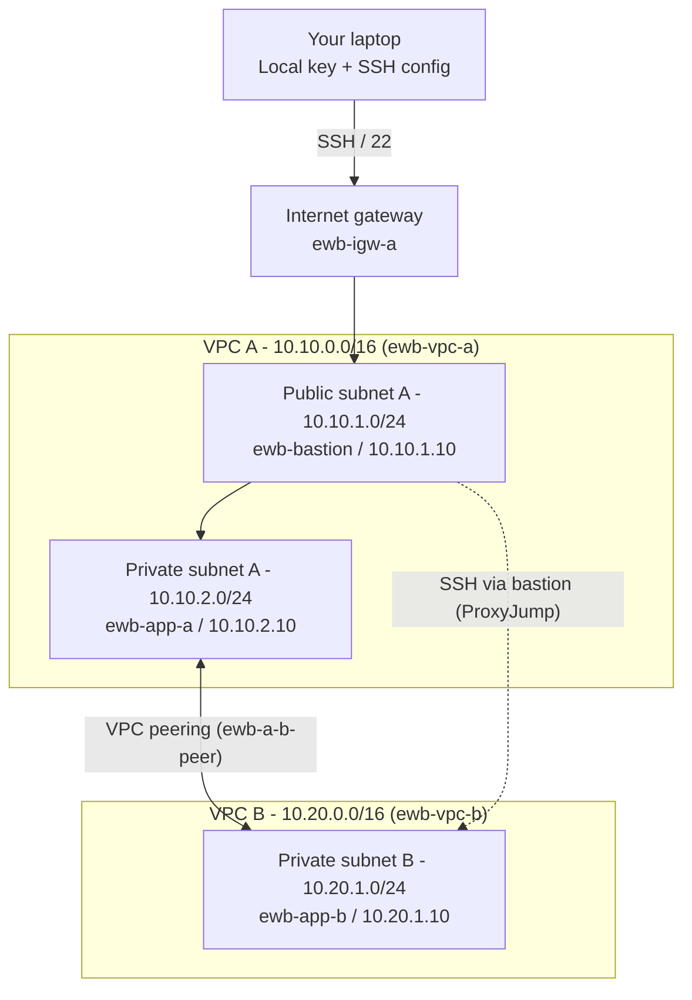

# AWS VPC Peering Project

> Connect two VPCs and prove private connectivity using EC2, custom route tables, security groups and a bastion host.

**Course:** EWB Courses – AWS Architect Associate (Project 01)
**Author:** _Your Name_  |  **Batch:** _Your Batch_
**Region:** _e.g. ap-south-1 (Mumbai)_  |  **Completed:** _DD Month YYYY_

---

## Table of Contents

1. [Overview](#overview)
2. [Architecture](#architecture)
3. [Address Plan](#address-plan)
4. [Resource Inventory](#resource-inventory)
5. [Build Steps](#build-steps)
6. [Security Group Rules](#security-group-rules)
7. [Route Tables](#route-tables)
8. [SSH Configuration (ProxyJump)](#ssh-configuration-proxyjump)
9. [Verification and Test Evidence](#verification-and-test-evidence)
10. [Troubleshooting Guide](#troubleshooting-guide)
11. [Concepts Explained](#concepts-explained)
12. [Cleanup](#cleanup)
13. [Repository Structure](#repository-structure)
14. [References](#references)

---

## Overview

EWB has an application in **VPC A** and a second workload in **VPC B**. Both application servers must stay **private** (no public IPv4). A VPC peering connection lets them talk over private IPv4 addresses, and a single public **bastion host** in VPC A is used for administration.

### What this project demonstrates

- Planning non-overlapping VPC and subnet CIDRs
- Creating public and private subnets with explicit route table associations
- Activating peering, configuring return routes and allowing only the required inbound traffic
- A failed test before peering, successful tests after peering, and a controlled failure

---

## Architecture



- **Administration:** laptop → bastion → App-A or App-B using SSH ProxyJump.
- **Project traffic:** App-A ↔ App-B over private IPs and the peering connection.
- The diagram is conceptual. The bastion opens a separate SSH connection to the destination. Peering does **not** give VPC B internet access through VPC A.

> Add your own exported diagram here: ``

---

## Address Plan

| Resource / Name tag | VPC or subnet | IPv4 CIDR / address |
|---|---|---|
| `ewb-vpc-a` | VPC A | `10.10.0.0/16` |
| `ewb-a-public` | VPC A / public subnet | `10.10.1.0/24` |
| `ewb-a-private` | VPC A / private subnet | `10.10.2.0/24` |
| `ewb-vpc-b` | VPC B | `10.20.0.0/16` |
| `ewb-b-private` | VPC B / private subnet | `10.20.1.0/24` |
| `ewb-bastion` | `ewb-a-public` | `10.10.1.10` + public IPv4 |
| `ewb-app-a` | `ewb-a-private` | `10.10.2.10` / no public IP |
| `ewb-app-b` | `ewb-b-private` | `10.20.1.10` / no public IP |

**Other resource names**

| Type | Name |
|---|---|
| Internet gateway | `ewb-igw-a` |
| Route tables | `ewb-rt-a-public`, `ewb-rt-a-private`, `ewb-rt-b-private` |
| Security groups | `ewb-sg-bastion`, `ewb-sg-app-a`, `ewb-sg-app-b` |
| Peering connection | `ewb-a-b-peer` |
| EC2 key pair | `ewb-lab` |

**Why these CIDRs?** `10.10.0.0/16` and `10.20.0.0/16` do not overlap. Each `/24` subnet belongs to its own VPC range. Different subnet ranges alone do not fix overlapping VPC CIDRs.

All resources are tagged `Project = EWB-VPC-Peering` and `Student = <your name>`.

---

## Resource Inventory

Fill this in with your **actual** IDs after building.

| Resource | ID |
|---|---|
| VPC A (`ewb-vpc-a`) | `vpc-xxxxxxxx` |
| VPC B (`ewb-vpc-b`) | `vpc-xxxxxxxx` |
| Subnet `ewb-a-public` | `subnet-xxxxxxxx` |
| Subnet `ewb-a-private` | `subnet-xxxxxxxx` |
| Subnet `ewb-b-private` | `subnet-xxxxxxxx` |
| Internet gateway | `igw-xxxxxxxx` |
| Route table `ewb-rt-a-public` | `rtb-xxxxxxxx` |
| Route table `ewb-rt-a-private` | `rtb-xxxxxxxx` |
| Route table `ewb-rt-b-private` | `rtb-xxxxxxxx` |
| Peering connection | `pcx-xxxxxxxx` |
| `ewb-bastion` | `i-xxxxxxxx` / `10.10.1.10` / public: `x.x.x.x` |
| `ewb-app-a` | `i-xxxxxxxx` / `10.10.2.10` |
| `ewb-app-b` | `i-xxxxxxxx` / `10.20.1.10` |

---

## Build Steps

### 1. Create VPC A
1. **VPC console → Your VPCs → Create VPC → VPC only.** Name `ewb-vpc-a`, CIDR `10.10.0.0/16`, no IPv6, tenancy Default.
2. **Create two subnets** in VPC A: `ewb-a-public` (`10.10.1.0/24`) and `ewb-a-private` (`10.10.2.0/24`), same Availability Zone.
3. **Internet gateway:** create `ewb-igw-a`, then *Actions → Attach to a VPC* → `ewb-vpc-a`.
4. **Public route table:** create `ewb-rt-a-public`, explicitly associate `ewb-a-public`, add `0.0.0.0/0 → ewb-igw-a` (keep the local route).
5. **Private route table:** create `ewb-rt-a-private`, explicitly associate `ewb-a-private`, keep only the local route. Leave auto-assign public IPv4 **disabled** on this subnet.

**Checkpoint 01:** two subnet associations + public default route captured; private route table contains only the local route.

### 2. Create VPC B
- `ewb-vpc-b` (`10.20.0.0/16`), subnet `ewb-b-private` (`10.20.1.0/24`), route table `ewb-rt-b-private` explicitly associated, local route retained, public IPv4 auto-assign disabled. **No internet gateway.**

### 3. Create security groups
See [Security Group Rules](#security-group-rules).

### 4. Launch the three instances
1. Create RSA key pair `ewb-lab` and download the `.pem`. Store it **only on your laptop**; never upload it to an EC2 instance.
2. Use Amazon Linux 2023 and a small x86 instance type (e.g. `t3.micro`). Check pricing and credits. Keep the root disk small with delete-on-termination enabled.

| Instance | Network settings | Security group |
|---|---|---|
| `ewb-bastion` | VPC A / `ewb-a-public`, IP `10.10.1.10`, auto-assign public IP **Enable** | `ewb-sg-bastion` |
| `ewb-app-a` | VPC A / `ewb-a-private`, IP `10.10.2.10`, auto-assign public IP **Disable** | `ewb-sg-app-a` |
| `ewb-app-b` | VPC B / `ewb-b-private`, IP `10.20.1.10`, auto-assign public IP **Disable** | `ewb-sg-app-b` |

**Checkpoint 02:** instance IDs, private IPs and bastion public IPv4 recorded; Public IPv4 is empty for App-A and App-B.

### 5. Establish peering (Request → Accept → Activate)

| Field | Value |
|---|---|
| Name | `ewb-a-b-peer` |
| Requester VPC | `ewb-vpc-a` |
| Account / Region | My account / This Region |
| Accepter VPC | `ewb-vpc-b` |

1. Create the peering connection.
2. *Actions → Accept request* (required even when both VPCs are in your account).
3. Wait for status **Active**; record the `pcx-…` ID.

**Checkpoint 03:** screenshot showing connection name, Active status and both VPC IDs. Peering alone does **not** make ping or SSH succeed; routes are required.

### 6. Add routes on both sides
See [Route Tables](#route-tables).

---

## Security Group Rules

| Security group | Type / port | Source |
|---|---|---|
| `ewb-sg-bastion` (VPC A) | SSH / TCP 22 | Your current public IPv4 `/32` |
| `ewb-sg-app-a` (VPC A) | SSH / TCP 22 | `10.10.1.10/32` (bastion private IP) |
| `ewb-sg-app-a` (VPC A) | Custom ICMP – IPv4, Echo request | `10.20.1.10/32` (App-B) |
| `ewb-sg-app-b` (VPC B) | SSH / TCP 22 | `10.10.1.10/32` (bastion private IP) |
| `ewb-sg-app-b` (VPC B) | Custom ICMP – IPv4, Echo request | `10.10.2.10/32` (App-A) |

Notes:
- Echo request = ICMP type 8, code 0.
- Default outbound allow-all is kept for this beginner lab. Security groups are stateful, so replies are allowed automatically.
- Default allow-all network ACLs are used (custom ACLs would need explicit return rules).
- Port and source are different fields: SSH uses port 22; the IP/CIDR goes in **Source**.
- App-B sees the **bastion's private IP** as the SSH source when accessed through ProxyJump.
- Never expose SSH or ICMP to `0.0.0.0/0`. If an IP changes, update the rule.

---

## Route Tables

**`ewb-rt-a-private`** → associated with `ewb-a-private`

| Destination | Target | Purpose |
|---|---|---|
| `10.10.0.0/16` | local | Existing VPC A route |
| `10.20.0.0/16` | `pcx-ID` | App-A to VPC B |

**`ewb-rt-b-private`** → associated with `ewb-b-private`

| Destination | Target | Purpose |
|---|---|---|
| `10.20.0.0/16` | local | Existing VPC B route |
| `10.10.0.0/16` | `pcx-ID` | Return path to VPC A |

**`ewb-rt-a-public`** → associated with `ewb-a-public`

| Destination | Target | Purpose |
|---|---|---|
| `10.10.0.0/16` | local | Bastion to App-A |
| `0.0.0.0/0` | `igw-ID` | Bastion internet access |
| `10.20.0.0/16` | `pcx-ID` | Bastion SSH to App-B |

**Why does the public subnet need a peering route?** ProxyJump makes the bastion open its own connection to App-B, so the bastion's subnet must know how to reach VPC B. The more specific `10.20.0.0/16` route is chosen over the internet default route.

**Checkpoint 04:** routes and subnet associations saved for all three tables. A one-way route is not enough: replies also need the route back.

---

## SSH Configuration (ProxyJump)

Run all SSH commands on your **laptop** (WSL, macOS or Linux):

```bash
mv ewb-lab.pem ~/.ssh/ewb-lab.pem
chmod 400 ~/.ssh/ewb-lab.pem
```

`~/.ssh/config`:

```ssh-config
Host ewb-bastion
    HostName BASTION_PUBLIC_IP
    User ec2-user
    IdentityFile ~/.ssh/ewb-lab.pem
    IdentitiesOnly yes

Host ewb-app-a
    HostName 10.10.2.10
    User ec2-user
    IdentityFile ~/.ssh/ewb-lab.pem
    IdentitiesOnly yes
    ProxyJump ewb-bastion

Host ewb-app-b
    HostName 10.20.1.10
    User ec2-user
    IdentityFile ~/.ssh/ewb-lab.pem
    IdentitiesOnly yes
    ProxyJump ewb-bastion
```

Replace `BASTION_PUBLIC_IP` with the bastion's current public IPv4. Test `ssh ewb-bastion`, `exit`, then `ssh ewb-app-a`. Both should work before peering. The private key is never copied to any instance.

---

## Verification and Test Evidence

> Record **real** terminal output. The table below lists acceptance criteria, not results. Replace the "Result" column with your own evidence.

| # | Test | Where / command | Expected | Result / Screenshot |
|---|---|---|---|---|
| 01 | Baseline | App-A, before peering: `ping -c 4 10.20.1.10` | No replies | `docs/screenshots/01-baseline.png` |
| 02 | Forward path | App-A, after routes: `ping -c 4 10.20.1.10` | 4 replies, 0% loss | `docs/screenshots/02-forward.png` |
| 03 | Reverse path | App-B, after routes: `ping -c 4 10.10.2.10` | 4 replies, 0% loss | `docs/screenshots/03-reverse.png` |
| 04 | Private SSH | Laptop: `ssh ewb-app-b` | Shell on App-B via bastion | `docs/screenshots/04-ssh-app-b.png` |
| 05 | Isolation | EC2 details for App-A and App-B | No public IPv4 on either host | `docs/screenshots/05-isolation.png` |

Commands to run inside each private host:

```bash
hostname
hostname -I
ping -c 4 PEER_PRIVATE_IP
```

### Controlled failure
1. Temporarily remove **only** the App-B inbound ICMP Echo rule from `10.10.2.10/32`.
2. Repeat the forward ping from App-A → replies should stop.
3. Restore the exact rule and rerun → replies should resume.
4. Keep the SSH rule in place throughout.

**Explanation (write your own):** _Describe why the ping failed even though peering and routes were still in place (the security group no longer allowed ICMP echo), and why it recovered once the rule was restored._

---

## Troubleshooting Guide

Check in this order: instance state → destination IP → subnet route table → security rule.

| Symptom | What to inspect |
|---|---|
| Bastion SSH times out | Current public IP; your public IP `/32` in the SSH rule; public subnet association; `0.0.0.0/0` route to the attached IGW |
| App-A SSH fails | App-A private IP; TCP 22 allowed from `10.10.1.10/32`; correct key, `ec2-user`, running instance |
| App-B SSH fails | Bastion public subnet needs `10.20.0.0/16 → pcx-ID`; VPC B needs the return route; App-B SSH source is the bastion private IP |
| Ping fails after acceptance | Both private route tables; correct pcx-ID and Active state; Echo request rule on destination; actual host IPs |
| Peering creation fails | Check every CIDR on both VPCs for overlap, including secondary CIDRs |
| `Permission denied (publickey)` | Correct key pair, local `IdentityFile`, `ec2-user`. Reaching SSH auth means routing works |
| Failure with custom ACLs | Check both directions, ICMP rules and SSH return ephemeral ports |

---

## Concepts Explained

**1. Why is the return route needed?**
Traffic is two-way. A request can reach the destination via one route, but the reply needs a route back to the source CIDR. Without it, replies are dropped and the connection fails.

**2. Why is the App-B SSH source the bastion private IP?**
With ProxyJump, the bastion opens a new SSH connection to App-B from inside the network, so App-B sees the bastion's private IP (`10.10.1.10`), not your laptop's public IP.

**3. Why does an Active peering not guarantee a successful ping?**
Peering is only the link. Route tables must point to it on both sides, and security groups (and NACLs) must allow the traffic.

**4. Can VPC B use VPC A's internet gateway over peering?**
No. Peering does not provide edge-to-edge routing, so VPC B cannot use VPC A's IGW.

**Core concepts**
- Peering is one-to-one and **non-transitive**: A–B plus A–C does **not** create B–C connectivity.
- Accepted connections can be deleted. Routes and security rules remain configurable; changing the paired VPCs requires a new connection.

---

## Cleanup

Save your evidence first. Remove only resources created for this project.

1. **Compute and credentials:** terminate `ewb-bastion`, `ewb-app-a`, `ewb-app-b`; confirm lab EBS volumes are deleted (delete leftover volumes/snapshots); release any Elastic IP; remove the unused lab key pair and local key if no longer needed.
2. **Peering and network:** delete peer routes and `ewb-a-b-peer`; delete lab security groups after instance network interfaces disappear; remove subnet associations as required, then delete lab subnets and custom route tables; detach and delete `ewb-igw-a`; delete both lab VPCs.
3. **Verify the account is clear:** filter by the `Project` tag and check EC2, volumes, public IPv4 allocations and VPC resources in your Region. Check Billing for remaining chargeable resources (usage reporting can lag). Capture cleanup evidence.

> **Cost note:** EC2, EBS and public IPv4 usage can incur charges. This lab needs **no NAT gateway**.

**What I learned:** _Write a short note here._

---

## Repository Structure

```
.
├── README.md
├── docs/
│   ├── architecture.png
│   └── screenshots/
│       ├── 01-baseline.png
│       ├── 02-forward.png
│       ├── 03-reverse.png
│       ├── 04-ssh-app-b.png
│       ├── 05-isolation.png
│       ├── 06-controlled-failure.png
│       └── 07-cleanup.png
├── ssh/
│   └── config.example        # no private keys!
└── YourName_EWB_VPC_Peering.pdf
```

> ⚠️ **Never commit** `.pem` files, passwords or access tokens. Add this to `.gitignore`:
> ```
> *.pem
> *.key
> ```

---

## Submission Checklist

- [ ] Cover: name, batch, project title, Region, completion date
- [ ] Architecture diagram and inventory with actual resource IDs and private IPs
- [ ] Subnet CIDRs and all three route tables with subnet associations
- [ ] Active peering connection and inbound rules for each security group
- [ ] Baseline failure, forward and reverse ping success, App-B SSH proof
- [ ] Controlled ICMP failure and recovery with a short explanation
- [ ] Cleanup evidence plus a short note on what I learned

Report PDF name: `YourName_EWB_VPC_Peering.pdf`. Label every screenshot with host, test and result.

---

## References

- [VPC peering concepts and limitations](https://docs.aws.amazon.com/vpc/latest/peering/)
- [Create a VPC peering connection](https://docs.aws.amazon.com/vpc/latest/peering/create-vpc-peering-connection.html)
- [Update route tables for peering](https://docs.aws.amazon.com/vpc/latest/peering/vpc-peering-routing.html)
- [Security groups for peered VPCs](https://docs.aws.amazon.com/vpc/latest/peering/vpc-peering-security-groups.html)
- [EC2 key pair security](https://docs.aws.amazon.com/AWSEC2/latest/UserGuide/ec2-key-pairs.html)
- [Amazon VPC pricing](https://aws.amazon.com/vpc/pricing/)

_Based on the EWB Courses student workbook, Project 01 (Oct 2026)._
